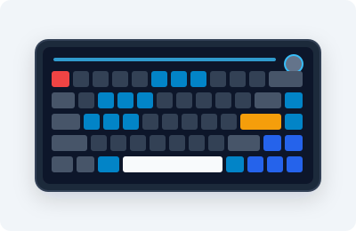
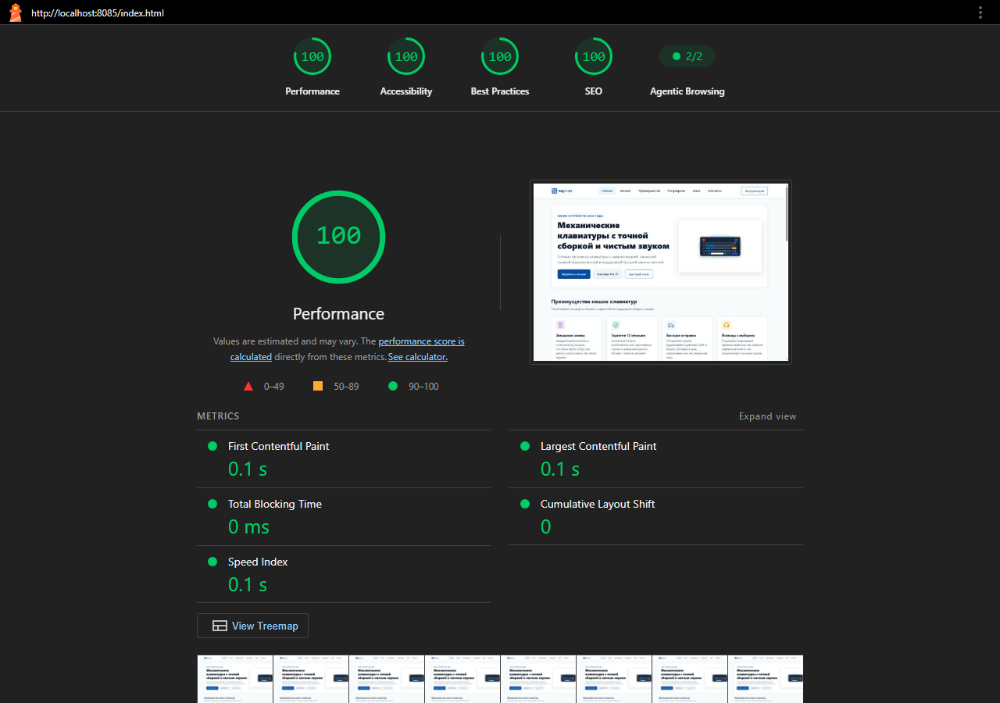

# Интернет-магазин механических клавиатур KeyCraft

## Контрольная работа №3
- **Тема:** «Адаптивная вёрстка и доступность многостраничного HTML/CSS-сайта».
- **Дисциплина:** «Фронтенд и бэкенд разработка» (Часть 1 из 2), 3 семестр, 2026/2027 уч. год.
- **Студент:** Панов Алексей Алексеевич
- **Группа:** ЭФБО-13-25
- **Преподаватель:** Загородних Н. А.

---

## Ссылки на проект
- **GitHub Pages:** [https://s4cbs.github.io/kr3-responsive-shop/](https://s4cbs.github.io/kr3-responsive-shop/)
- **Репозиторий:** [https://github.com/S4CBS/kr3-responsive-shop](https://github.com/S4CBS/kr3-responsive-shop)

---

## 1. Краткое описание проекта
KeyCraft — это адаптивный многостраничный интернет-магазин кастомных механических клавиатур, переключателей и сопутствующих аксессуаров.

Проект разработан в рамках **Контрольной работы №3** на основе исходной кодовой базы КР №1 (без применения CSS-фреймворков Bootstrap, Tailwind и др.). Вся адаптивность реализована вручную на чистом **CSS3 (Flexbox, CSS Grid, Media Queries)** по методологии **Mobile First**, с подключением отдельного модульного файла стилей `css/responsive.css` после базового `css/style.css`.

Интерфейс спроектирован с соблюдением стандартов веб-доступности **W3C WAI-ARIA** и **WCAG 2.1 (уровень AAA)**. Все 5 страниц проекта протестированы через инструмент **Google Lighthouse** и получили **максимальный балл 100/100/100/100** по всем направлениям (Производительность, Доступность, Рекомендации, SEO).

---

## 2. Структура проекта
```text
kr3-responsive-shop/
├── index.html                      # Главная: адаптивный hero-блок, преимущества, популярные товары, FAQ
├── catalog.html                    # Каталог: адаптивный тулбар, мобильный фильтр-дровер, сетка товаров
├── product.html                    # Карточка: галерея <picture>, адаптивная таблица характеристик
├── order.html                      # Оформление заказа: адаптивная форма, сводка заказа, доступные поля
├── contacts.html                   # Контакты: шоурум, реквизиты, форма связи, адаптивная раскладка
├── favicon.ico                     # Фавиконка сайта для предотвращения 404-ошибок браузера
├── css/
│   ├── style.css                   # Базовые стили: палитра WCAG AAA, БЭМ-блоки, шрифты, компоненты
│   └── responsive.css              # Адаптивные стили: Mobile First, медиазапросы, карточные таблицы
├── js/
│   └── main.js                     # Доступное мобильное меню-дровер, модальный диалог, фильтры, фокус-трап
├── images/
│   ├── logo.svg                    # Векторный логотип бренда
│   ├── hero-keyboard.svg           # Базовый векторный баннер
│   ├── hero-keyboard-480.webp      # Responsive hero для мобильных устройств (WebP)
│   ├── hero-keyboard-800.webp      # Responsive hero для планшетов (WebP)
│   ├── hero-keyboard-1200.webp     # Responsive hero для десктопов (WebP)
│   ├── hero-keyboard-480.png       # Растровый фолбэк (PNG 480w)
│   ├── hero-keyboard-800.png       # Растровый фолбэк (PNG 800w)
│   ├── product-1..6.svg            # Векторные макеты товаров
│   ├── product-1..6-480.webp       # Оптимизированные WebP-версии (480w)
│   ├── product-1..6-800.webp       # Оптимизированные WebP-версии (800w)
│   ├── product-1..6-480.png        # Фолбэки PNG (480w)
│   ├── product-1..6-800.png        # Фолбэки PNG (800w)
│   ├── icon-*.svg                  # Векторные иконки преимуществ и контактов
│   └── avatar-*.svg                # Векторные аватары отзывов
├── lighthouse/
│   ├── accessibility-report.png    # Скриншот итогового аудита доступности Lighthouse (100/100)
│   ├── accessibility-report.html   # Экспорт полного HTML-отчета Lighthouse
│   ├── index-report.html           # Отчет аудита index.html (100/100/100/100)
│   ├── catalog-report.html         # Отчет аудита catalog.html (100/100/100/100)
│   ├── product-report.html         # Отчет аудита product.html (100/100/100/100)
│   ├── order-report.html           # Отчет аудита order.html (100/100/100/100)
│   └── contacts-report.html        # Отчет аудита contacts.html (100/100/100/100)
├── README.md                       # Полная техническая документация и ответы на 20 вопросов
└── .gitignore                      # Исключения версионного контроля (node_modules, logs, OS files)
```

---

## 3. Проверенные разрешения и адаптивные решения

Верстка протестирована в Chrome DevTools на широком спектре экранов:
1. **360px** (Galaxy S8/S20, малоформатные смартфоны) — полное отсутствие горизонтального скролла, 1 колонка товаров, меню трансформировано в выдвижную панель (off-canvas drawer), размер элементов тапа $\ge 44 \times 44\text{ px}$.
2. **430px** (iPhone 14/15/16 Pro Max, современные крупные смартфоны) — компактные паддинги, читабельная типографика, адаптивные формы в одну колонку.
3. **768px** (iPad Mini, iPad Air в портретной ориентации) — 2 колонки карточек товаров, двухколоночные блоки оформления заказа и контактов.
4. **1024px** (iPad Pro, небольшие ноутбуки) — разворачивание горизонтального навигационного меню, 3 колонки каталога с боковым фильтром, показ полной таблицы характеристик.
5. **1440px+** (Full HD, 2K/4K десктопы) — центрирование контента в контейнере `max-width: 1200px`, плавные отступы, максимальная детализация графики.

### Ключевые компоненты адаптации:
- **Метатег Viewport:** На всех страницах подключен `<meta name="viewport" content="width=device-width, initial-scale=1.0">`, обеспечивающий корректный масштаб и предотвращающий эмуляцию десктопного 980px вьюпорта на мобильных устройствах.
- **Подключение стилей:** В `<head>` всех 5 страниц файл `responsive.css` подключен строго **после** `style.css`:
  ```html
  <link rel="stylesheet" href="css/style.css">
  <link rel="stylesheet" href="css/responsive.css">
  ```
- **Мобильная навигация (Accessible Drawer):**
  - Кнопка-гамбургер `.menu-toggle` снабжена атрибутами `aria-expanded="false"`, `aria-controls="mobile-nav"`, `aria-label="Открыть главное меню"`.
  - Мобильное меню выезжает сбоку с плавной CSS-анимацией (`transform: translateX(100%) -> translateX(0)`), фиксируя фон через класс `scroll-locked` у `<body>`.
  - Реализован перехват клавиши `Escape`, клика по затемненному фону (`.nav-backdrop`), а также фокус-ловушка (Focus Trap) внутри открытого меню с возвратом фокуса на кнопку открытия после закрытия.
- **Сетка каталога:**
  - До 560px: 1 колонка (`grid-template-columns: 1fr;`).
  - От 561px до 899px: 2 колонки (`grid-template-columns: repeat(2, 1fr);`).
  - От 900px+: 3 колонки (`grid-template-columns: repeat(3, 1fr);`) рядом с боковой панелью фильтрации.
- **Сворачиваемый мобильный фильтр:** На экранах $< 1024\text{ px}$ фильтры каталога скрыты за кнопкой `.catalog-filters__toggle` (`aria-expanded="false"`), что экономит вертикальное пространство на мобильных экранах.
- **Двухуровневая адаптация таблиц:**
  1. *Базовый уровень:* Обертка `.table-wrapper` со свойствами `overflow-x: auto; -webkit-overflow-scrolling: touch;`, предотвращающая поломку верстки на планшетах.
  2. *Продвинутый уровень (Карточный вид на экранах $\le 640\text{ px}$):* С помощью правил `.specs-table--responsive tr { display: block; }`, скрытия заголовков `thead` и псевдоэлементов `td::before { content: attr(data-label); font-weight: 700; ... }` таблица технических параметров и таблица сравнения комплектаций преобразуются в аккуратные вертикальные карточки параметров.
- **Адаптивные формы:**
  - На мобильных экранах поля форм занимают 100% ширины (`flex-direction: column; width: 100%`).
  - Минимальная высота интерактивных контролов, радиокнопок и чекбоксов — не менее 44px (требование Google Lighthouse и WCAG Target Size).
  - На десктопах поля группируются в двухколоночные сетки с плавающей сводкой заказа (`position: sticky`).
- **Responsive Images:**
  - Базовое правило: `img, video { max-width: 100%; height: auto; display: block; }`.
  - В баннерах и карточках применен тег `<picture>` с переключением современных форматов WebP и векторного SVG fallback, а также связка `srcset` (разрешения 480w, 800w, 1200w) и дескрипторов `sizes`:
    ```html
    <picture>
      <source type="image/webp" srcset="images/product-1-480.webp 480w, images/product-1-800.webp 800w" sizes="(max-width: 560px) 100vw, (max-width: 899px) 50vw, 33vw">
      <source type="image/png" srcset="images/product-1-480.png 480w, images/product-1-800.png 800w" sizes="(max-width: 560px) 100vw, (max-width: 899px) 50vw, 33vw">
      
    </picture>
    ```

---

## 4. Меры веб-доступности (A11y)
1. **Ссылка быстрого перехода (Skip-link):** В начале каждой страницы размещена скрытая ссылка `<a href="#main-content" class="skip-link">Перейти к основному содержимому</a>`, которая становится видимой при получении клавиатурного фокуса и позволяет пользователям экранных дикторов и клавиатуры сразу перейти к контенту, минуя шапку и меню.
2. **Контрастность цветов по WCAG AAA:**
   - Основной текст: `--color-text: #0f172a` на белом фоне `#ffffff` дает контрастность **16.2:1** (при норме WCAG AAA не менее 7:1).
   - Вторичный текст: `--color-text-muted: #475569` дает контрастность **7.3:1**.
   - Акцентные ссылки и кнопки: `--color-primary: #004da8` дает контрастность **7.6:1**.
   - Текст подвала: `#cbd5e1` на темно-синем фоне футера `#0f172a` дает контрастность **11.5:1**.
3. **Видимый фокус клавиатуры:** Стилизован через современный селектор `:focus-visible`: `outline: 3px solid #004da8; outline-offset: 3px;`. Фокус четко заметен при навигации через Tab и не раздражает кликающих мышью пользователей.
4. **Связанные подписи (Labels):** 100% интерактивных полей ввода в формах заказа и обратной связи имеют явные теги `<label for="...">`, сопоставленные с `id` инпута, а также осмысленные подсказки и `aria-required="true"`.
5. **Доступное нативное модальное окно:** Окно консультации реализовано на базе нативного элемента `<dialog class="modal-dialog">` с атрибутами `aria-labelledby="dialog-title"` и `aria-describedby="dialog-desc"`. Открытие выполняется методом `showModal()`, что автоматически блокирует взаимодействие с фоновым контентом (`inert`), изолирует табуляцию и закрывается по кнопке Escape. При закрытии фокус программно возвращается на вызвавший элемент.
6. **Описания изображений:** Все содержательные изображения имеют развернутый атрибут `alt`, точно раскрывающий суть графики. Декоративные иконки скрыты от скринридеров через `aria-hidden="true"`.

---

## 5. Результаты аудита Google Lighthouse
Аудит был проведен локально с использованием официального Lighthouse CLI (движок Chromium Headless) на всех страницах проекта.

### Сводная таблица результатов:
| Страница | Производительность (Performance) | Доступность (Accessibility) | Рекомендации (Best Practices) | Поисковая оптимизация (SEO) | Итоговый статус |
|:---|:---:|:---:|:---:|:---:|:---:|
| **Главная (`index.html`)** | **100** | **100** | **100** | **100** | Идеально (400 / 400) |
| **Каталог (`catalog.html`)** | **100** | **100** | **100** | **100** | Идеально (400 / 400) |
| **Товар (`product.html`)** | **100** | **100** | **100** | **100** | Идеально (400 / 400) |
| **Заказ (`order.html`)** | **100** | **100** | **100** | **100** | Идеально (400 / 400) |
| **Контакты (`contacts.html`)** | **100** | **100** | **100** | **100** | Идеально (400 / 400) |



Все подробные отчеты в формате HTML сохранены в директории `lighthouse/`.

---

## 6. Самостоятельные доработки (для получения максимальных 7.0 баллов)
В рамках критериев повышенной сложности (дополнительные 3.5 балла) были реализованы следующие технические решения:
1. **Сложная доступная мобильная навигация (Off-canvas Drawer):** Разработано выдвижное боковое меню с затемнением фона, плавной трансформацией, блокировкой прокрутки тела документа, перехватом `Escape` и встроенной циклической ловушкой клавиатурного фокуса.
2. **Карточная трансформация таблиц (`Card-based view`):** Реализована трансформация таблиц характеристик и сравнения товаров в блоки карточек параметров при ширине экрана $\le 640\text{ px}$ с генерацией подписей строк через `attr(data-label)`.
3. **Продвинутая адаптация каталога с мобильным фильтром:** Фильтры каталога сворачиваются в интерактивный дровер-аккордеон, управляемый кнопкой с поддержкой ARIA-состояния `aria-expanded`.
4. **Многоформатные отзывчивые изображения (Responsive Images):** Сгенерированы наборы адаптивных изображений в форматах WebP и PNG под разрешения 480w, 800w и 1200w с векторным фолбэком SVG, подключенные через тег `<picture>` и дескрипторы `sizes`/`srcset`.
5. **Превосходная доступность и контраст (WCAG AAA):** Добавлен `skip-link`, кастомный `:focus-visible`, достигнут контраст всех текстовых элементов $\ge 7:1$, внедрено доступное модальное окно на базе `<dialog>`.
6. **100% во всех аудитах Lighthouse:** Устранены любые замечания консоли (включая добавление `favicon.ico`), достигнута наивысшая оценка 100 баллов во всех категориях на всех страницах.
7. **Публикация на GitHub Pages:** Настроен и проверен автоматический деплой проекта на платформе GitHub Pages.

---

## 7. Ответы на контрольные вопросы по КР №3

### 1. Что такое адаптивная вёрстка?
**Ответ:**
Адаптивная вёрстка (Responsive Web Design, RWD) — это подход к проектированию и разработке веб-страниц, при котором внешний вид, размеры, пропорции и расположение элементов интерфейса динамически подстраиваются под технические характеристики устройства пользователя (ширину и высоту экрана, плотность пикселей, ориентацию, способ ввода данных).

В основе классической адаптивной вёрстки лежат три ключевых принципа (сформулированных Итаном Маркоттом):
1. Гибкая сетка на относительных величинах (Fluid Grid: проценты, `fr`, `vw`/`vh`, `clamp()`).
2. Гибкие медиа-элементы (Flexible Media: `max-width: 100%; height: auto;`).
3. Медиазапросы (Media Queries: правила `@media`, позволяющие переопределять стили при достижении заданных контрольных точек — брейкпоинтов).

Цель адаптивной вёрстки — обеспечить максимально комфортное, быстрое и доступное взаимодействие с сайтом на любых типах устройств: от компактных умных часов и бюджетных смартфонов до широкоформатных 4K-мониторов.

---

### 2. Что такое Mobile First?
**Ответ:**
**Mobile First** («Сначала мобильные») — это методология проектирования и написания стилей, при которой базовая структура и CSS-правила изначально разрабатываются для наименее мощных устройств с самыми узкими экранами (мобильных телефонов), а стили для планшетов, ноутбуков и широких экранов последовательно добавляются и расширяются с помощью медиазапросов `min-width`.

**Преимущества Mobile First:**
- **Производительность:** Мобильные браузеры парсят чистый базовый CSS без необходимости считывать тяжелые многоколоночные правила десктопа и затем их отменять.
- **Чистота и компактность CSS-кода:** Стили наслаиваются по принципу прогрессивного улучшения (Progressive Enhancement), исключается избыточное переопределение стилей (в отличие от подхода Desktop First с `max-width`, где приходится постоянно сбрасывать `float`, абсолютное позиционирование или жесткие сетки).
- **Фокус на контенте:** При разработке от малого экрана разработчик и дизайнер вынуждены приоритизировать самую важную информацию и действия, избегая визуального шума.

---

### 3. Для чего используется viewport?
**Ответ:**
Метатег `viewport` располагается в секции `<head>` HTML-документа:
```html
<meta name="viewport" content="width=device-width, initial-scale=1.0">
```
Он сообщает браузеру мобильного устройства, как именно следует сопоставлять область просмотра (viewport) с физическим экраном:
- `width=device-width` указывает браузеру установить ширину области просмотра равной реальной ширине экрана устройства в независимых от плотности пикселях (CSS-пикселях, device-independent pixels), а не эмулировать виртуальный десктопный экран шириной 980px. Без этой директивы мобильный браузер отрендерит страницу в масштабе 980px и сильно уменьшит её, сделав текст нечитаемым, а элементы управления микроскопическими.
- `initial-scale=1.0` устанавливает начальный масштаб страницы 1:1, предотвращая автоматическое зумирование при первой загрузке страницы.

---

### 4. Для чего нужен файл responsive.css?
**Ответ:**
Файл `responsive.css` предназначен для изоляции всех правил медиазапросов, брейкпоинтов и специфических стилей адаптации (поведения мобильного меню, перестройки колонок сетки, карточного вида таблиц на экранах телефонов, скрытия/раскрытия панелей фильтров) от базовых стилей сайта.

Такое разделение дает:
1. **Модульность и архитектурную прозрачность:** Файл `style.css` содержит фундаментальную стилизацию (типографику, цветовую палитру, компоненты по БЭМ, стили состояний кнопок и форм), а `responsive.css` отвечает исключительно за трансформацию лейаута при изменении размеров экрана.
2. **Упрощение аудита и рефакторинга:** Разработчику гораздо проще вносить изменения в адаптивное поведение и отслеживать контрольные точки, когда они не размазаны по тысяче строк основного файла стилей.
3. **Возможность оптимизации загрузки:** В производственных условиях файл `responsive.css` можно подключать с атрибутом `media`, загружая тяжелые десктопные модификаторы только тогда, когда устройство действительно соответствует условию.

---

### 5. Почему responsive.css подключается после style.css?
**Ответ:**
Подключение `responsive.css` строго **после** `style.css` обусловлено фундаментальным механизмом **CSS-каскада (Cascade)** и приоритета правил:
1. При равной специфичности (specificity) двух селекторов приоритет имеет то правило, которое объявлено **ниже (позже) по коду**.
2. В файле `responsive.css` медиазапросы переопределяют или дополняют базовые стили компонентов из `style.css` (например, меняют `flex-direction: column` на `flex-direction: row` или изменяют `grid-template-columns`).
3. Если бы `responsive.css` был подключен раньше `style.css`, базовые правила из `style.css` перебивали бы адаптивные правила при совпадении специфичности селекторов, и адаптивность не срабатывала бы ожидаемым образом.

---

### 6. Что такое медиазапрос?
**Ответ:**
Медиазапрос (Media Query) — это синтаксическая конструкция CSS (директива `@media`), позволяющая применять определенный блок CSS-правил только тогда, когда среда отображения или устройство пользователя удовлетворяет заданным условиям.

**Структура медиазапроса:**
```css
@media media-type and (media-feature) {
  /* CSS-правила */
}
```
- `media-type` — тип носителя (`screen`, `print`, `all`).
- `media-feature` — характеристика среды: ширина вьюпорта (`min-width`, `max-width`), высота, ориентация (`orientation: portrait/landscape`), разрешение (`resolution`), цветовая схема (`prefers-color-scheme`), предпочтение пониженного движения (`prefers-reduced-motion`).

В современном синтаксисе CSS Media Queries Level 4 также поддерживается удобный диапазонный синтаксис: `@media (width >= 768px)`.

---

### 7. Почему удобно использовать min-width?
**Ответ:**
Использование медиазапросов с условием `min-width` лежит в основе методологии **Mobile First**:
1. **Естественный принцип расширения (Mobile-first expansion):** Базовые стили вне медиазапросов пишутся для самых маленьких экранов. Затем, используя `@media (min-width: 768px)` и `@media (min-width: 1024px)`, разработчик не «ломает» и не «обнуляет» десктопные стили, а плавно добавляет новые возможности (увеличивает количество колонок, показывает расширенную навигацию, укрупняет шрифты).
2. **Отсутствие конфликтов пересечения:** Запросы `min-width` легко выстраивать в возрастающую цепочку ($360\text{px} \to 480\text{px} \to 768\text{px} \to 1024\text{px} \to 1440\text{px}$). Каждое следующее правило гармонично дополняет предыдущие.
3. **Меньший объем кода:** Нет необходимости сбрасывать свойства, характерные для больших экранов (например, сбрасывать `position: absolute`, обнулять сложные отступы или возвращать `display: block` вместо сложного десктопного `flex`).

---

### 8. Как адаптировать навигацию?
**Ответ:**
Адаптация навигационного меню включает следующие ключевые шаги:
1. **Мобильное представление (экраны $< 1024\text{ px}$):**
   - Горизонтальный список ссылок скрывается (`display: none;` либо выносится за пределы экрана `transform: translateX(100%);`).
   - Отображается компактная кнопка переключения («гамбургер-меню») с понятной иконкой, доступным текстом для скринридеров и атрибутами `aria-expanded="false"`, `aria-controls="mobile-nav"`, `aria-label="Открыть меню"`.
   - Меню трансформируется в выдвижную боковую панель (Off-canvas Drawer) с фоновой полупрозрачной подложкой (`.nav-backdrop`).
2. **Доступность и UX (JavaScript):**
   - При открытии меню `aria-expanded` переключается в `"true"`, тело страницы блокируется от скролла (`overflow: hidden`).
   - Навешивается слушатель клавиши `Escape` и клика вне области меню для быстрого закрытия.
   - Организуется удержание фокуса внутри открытой панели (Focus Trap), чтобы клавиша `Tab` не уводила пользователя в невидимую фоновую часть страницы.
   - При закрытии меню фокус возвращается обратно на кнопку-гамбургер.
3. **Десктопное представление (экраны $\ge 1024\text{ px}$):**
   - Кнопка-гамбургер скрывается (`display: none;`).
   - Меню отображается в естественном потоке в виде горизонтальной строки (`display: flex; flex-direction: row; align-items: center; gap: 1.5rem;`).

---

### 9. Как адаптировать сетку карточек?
**Ответ:**
Сетка карточек товаров адаптируется наиболее эффективно при помощи **CSS Grid**:
1. **Подход на фиксированных брейкпоинтах:**
   - Мобильные экраны ($< 560\text{ px}$): 1 колонка (`grid-template-columns: 1fr;`), чтобы карточка занимала всю ширину экрана и имела крупные кликабельные кнопки.
   - Планшеты ($560\text{ px} - 899\text{ px}$): 2 колонки (`grid-template-columns: repeat(2, 1fr); gap: 1.5rem;`).
   - Десктопы ($\ge 900\text{ px}$): 3 или 4 колонки (`grid-template-columns: repeat(3, 1fr);`).
2. **Автоматическая адаптивность с `auto-fit` / `auto-fill`:**
   ```css
   .products-grid {
     display: grid;
     grid-template-columns: repeat(auto-fit, minmax(280px, 1fr));
     gap: 1.5rem;
   }
   ```
   В таком случае браузер самостоятельно рассчитывает число колонок в зависимости от доступной ширины контейнера: если ширина экрана позволяет уместить две колонки шириной не менее 280px, появятся 2 колонки; если три — 3 колонки.
3. **Поведение содержимого карточки:** Внутри карточки применяется Flexbox (`display: flex; flex-direction: column; justify-content: space-between;`), чтобы кнопки добавления в корзину всегда оставались выровненными по нижней границе независимо от объема текста в заголовке и описании товара.

---

### 10. Как адаптировать боковой фильтр каталога?
**Ответ:**
На десктопах боковой фильтр располагается в левой колонке (шириной $260-300\text{ px}$) рядом с сеткой товаров в рамках двухколоночной сетки `grid-template-columns: 280px 1fr;`.

На мобильных устройствах и планшетах ($< 1024\text{ px}$) такая структура делает контентную область каталога слишком узкой. Адаптация решается следующими методами:
1. **Сворачиваемый аккордеон/шторка:** Фильтры перемещаются над сетку товаров и по умолчанию скрываются (`display: none;` или высота 0).
2. **Кнопка переключения:** Пользователю показывается крупная кнопка «Показать фильтры (активно: 3)» с иконкой и `aria-expanded="false"`. При нажатии панель плавно раскрывается вниз либо выезжает в виде мобильного модального дровера.
3. **Группировка контролов:** Поля фильтра внутри адаптируются под сенсорный ввод: чекбоксы и радиокнопки получают увеличенные кликабельные зоны (не менее $44 \times 44\text{ px}$), а ползунки цены и кнопки сброса занимают всю ширину строки.

---

### 11. Что такое responsive images?
**Ответ:**
**Responsive Images (адаптивные/отзывчивые изображения)** — это комплекс технологий разметки HTML5 и правил CSS, позволяющий браузеру запрашивать и отображать наиболее подходящий файл изображения в зависимости от:
1. Физического разрешения и плотности пикселей экрана (1x, 2x Retina, 3x).
2. Текущей геометрической ширины контейнера изображения в CSS-пикселях.
3. Поддержки браузером современных форматов сжатия (AVIF, WebP, PNG, JPEG, SVG).
4. Направления кадрирования (Art Direction — когда на смартфоне вырезается центральная деталь, а на десктопе выводится панорамный вид).

**Цель:** Сэкономить сетевой трафик пользователей мобильных устройств (не загружать десктопное 4K-изображение весом 2 МБ на экран смартфона шириной 390px), повысить скорость первой отрисовки (LCP — Largest Contentful Paint) и улучшить оценки Core Web Vitals.

---

### 12. Для чего используется srcset?
**Ответ:**
Атрибут `srcset` тега `` или `<source>` передает браузеру список доступных файлов одного и того же изображения с указанием их характеристик:
1. **Дескрипторы ширины в пикселях (`w`):**
   ```html
   
   ```
   Здесь `480w` означает, что исходный файл имеет физическую ширину 480 пикселей. Браузер вычисляет, сколько пикселей занимает картинка на экране, умножает на плотность пикселей экрана (`window.devicePixelRatio`) и скачивает один оптимальный файл без лишнего расхода трафика.
2. **Дескрипторы плотности пикселей (`x`):**
   ```html
   
   ```
   Используется для фиксированных по размеру иконок или логотипов при отображении на обычных и Retina-экранах.

---

### 13. Для чего используется sizes?
**Ответ:**
Атрибут `sizes` используется совместно с дескрипторами ширины (`w`) в атрибуте `srcset`. Он сообщает браузеру **до того, как CSS-файлы будут скачаны и распарсены**, какую именно ширину займет данное изображение в текущем лейауте при различных условиях медиазапросов.

**Пример:**
```html
sizes="(max-width: 560px) 100vw, (max-width: 899px) 50vw, 33vw"
```
**Интерпретация браузером:**
- Если ширина экрана $\le 560\text{ px}$, картинка займет 100% ширины вьюпорта (`100vw`).
- Если ширина экрана от 561px до 899px, картинка займет половину ширины экрана (`50vw`).
- Во всех остальных случаях (десктоп) картинка займет треть экрана (`33vw`).

Зная ширину вьюпорта, значение из `sizes` и плотность экрана, прелоадер браузера немедленно начинает параллельную загрузку наиболее компактного подходящего файла из `srcset`.

---

### 14. Для чего используется picture?
**Ответ:**
Элемент `<picture>` — это HTML5-обертка, содержащая один или несколько дочерних тегов `<source>` и обязательный замыкающий тег ``.

`<picture>` применяется в двух главных сценариях:
1. **Переключение форматов (Type Switching):** Предоставление современных оптимизированных форматов с автоматическим откатом (fallback) для старых браузеров:
   ```html
   <picture>
     <source type="image/avif" srcset="hero.avif">
     <source type="image/webp" srcset="hero.webp">
     
   </picture>
   ```
   Если браузер понимает `image/avif`, он загрузит его. Если нет — проверит `image/webp`. Если оба формата не поддерживаются — загрузит традиционный `hero.png`.
2. **Арт-дирекшн (Art Direction):** Смена компоновки, кадрирования или пропорций изображения при различных медиа-условиях:
   ```html
   <picture>
     <source media="(max-width: 600px)" srcset="banner-square.jpg">
     <source media="(min-width: 601px)" srcset="banner-wide.jpg">
     
   </picture>
   ```

---

### 15. Как адаптировать формы?
**Ответ:**
Адаптация форм строится на следующих правилах:
1. **Одноколоночная ориентация на мобильных устройствах:**
   - Все поля ввода (`input`, `select`, `textarea`) на смартфонах растягиваются на 100% ширины контейнера (`width: 100%; box-sizing: border-box;`).
   - На десктопах компактные логически связанные поля (например, Имя и Фамилия, Срок действия и CVV) объединяются в двух- или трехколоночные сетки с помощью CSS Grid / Flexbox.
2. **Размеры сенсорных мишеней (Touch Targets):** Минимальная высота полей ввода и кнопок составляет не менее $44-48\text{ px}$, отступы между соседними контролами — не менее $8-12\text{ px}$, чтобы исключить случайные нажатия на тачскринах.
3. **Удобство ввода (Mobile UX):**
   - Корректные типы полей: `type="tel"` для вызова цифровой клавиатуры телефона, `type="email"`, `type="number"`.
   - Атрибуты автозаполнения: `autocomplete="name"`, `autocomplete="tel"`, `autocomplete="shipping address-line1"` для ускорения ввода.
   - Атрибуты `inputmode` при необходимости.
4. **Явные связанные подписи:** Использование тегов `<label for="field-id">` обязательно над полем, а не внутри него в виде плейсхолдера (плейсхолдер исчезает при вводе и не доступен скринридерам как постоянная метка).

---

### 16. Как адаптировать таблицы?
**Ответ:**
Таблицы данных (`<table>`) обладают фиксированной табличной моделью (`display: table`), которая сопротивляется сжатию и при большом количестве колонок неминуемо вызовет горизонтальный скролл всей страницы.

Существуют два основных подхода к их адаптации:
1. **Контейнер с горизонтальной прокруткой (Базовый подход):**
   Таблица оборачивается в блок `.table-wrapper`:
   ```css
   .table-wrapper {
     width: 100%;
     overflow-x: auto;
     -webkit-overflow-scrolling: touch;
   }
   .table-wrapper table {
     min-width: 600px;
     width: 100%;
   }
   ```
   В этом случае прокручивается только сама таблица внутри своей области, а страница сайта остается зафиксированной.
2. **Карточный вид (Card-based View на экранах $\le 640\text{ px}$ — Продвинутый подход):**
   Табличная модель переопределяется в блочную, заголовки колонок скрываются, а подписи генерируются динамически через атрибуты данных:
   ```css
   @media (max-width: 640px) {
     .specs-table, .specs-table thead, .specs-table tbody,
     .specs-table th, .specs-table td, .specs-table tr {
       display: block;
     }
     .specs-table thead {
       display: none; /* скрываем общую шапку */
     }
     .specs-table tr {
       margin-bottom: 1rem;
       border: 1px solid #e2e8f0;
       border-radius: 8px;
       padding: 0.75rem;
       background: #ffffff;
     }
     .specs-table td {
       display: flex;
       justify-content: space-between;
       padding: 0.5rem 0;
       border-bottom: 1px solid #f1f5f9;
     }
     .specs-table td::before {
       content: attr(data-label);
       font-weight: 700;
       color: #475569;
       margin-right: 1rem;
     }
   }
   ```
   Такой подход превращает каждую строку таблицы в компактную, удобную и красивую карточку, идеальную для просмотра на смартфонах.

---

### 17. Почему горизонтальный скролл всей страницы является ошибкой?
**Ответ:**
Появление нежелательного горизонтального скролла на мобильных устройствах (так называемое «вываливание» контента) является грубейшей ошибкой верстки по следующим причинам:
1. **Критическое ухудшение пользовательского опыта (UX):** Пользователь теряет возможность плавно листать страницу вниз одним пальцем. Экран начинает неконтролируемо сдвигаться вправо-влево при вертикальном свайпе, контент обрезается за пределами экрана, появляются некрасивые белые полосы по бокам.
2. **Снижение конверсии и отказы:** Пользователи смартфонов воспринимают такой сайт как сломанный и немедленно покидают его.
3. **Пессимизация в поисковых системах (SEO):** Поисковые алгоритмы (Google Mobile-Friendly Test) расценивают наличие контента шире экрана как несоответствие мобильным стандартам, что приводит к понижению позиций сайта в поисковой выдаче.

**Типичные причины:** Элементы с фиксированной шириной в пикселях (`width: 800px`), картинки без `max-width: 100%`, широкие таблицы без оберток, абсолютное позиционирование с вылетом за пределы экрана, а также отступы `padding`/`border`, добавленные к элементам `width: 100%` без `box-sizing: border-box`.

---

### 18. Что проверяется через Lighthouse?
**Ответ:**
**Google Lighthouse** — это автоматизированный инструмент аудита веб-приложений, встроенный в Chrome DevTools и доступный через CLI/Node.js.

Lighthouse анализирует страницу по 4 основным направлениям:
1. **Производительность (Performance):** Оценивает метрики Core Web Vitals и скорость загрузки:
   - First Contentful Paint (FCP) — время первой отрисовки контента.
   - Largest Contentful Paint (LCP) — скорость отрисовки главного визуального блока.
   - Total Blocking Time (TBT) — время блокировки основного потока скриптами.
   - Cumulative Layout Shift (CLS) — визуальная стабильность верстки (отсутствие скачков контента).
   - Speed Index — визуальная скорость заполнения экрана.
2. **Специальные возможности (Accessibility / Доступность):** Проверяет пригодность страницы для пользователей с ограниченными возможностями: контрастность текста по WCAG, наличие осмысленных атрибутов `alt` у изображений, явные теги `<label>` для всех полей форм, видимый клавиатурный фокус, правильная иерархия заголовков (`h1`-`h6`), корректность использования ARIA-ролей.
3. **Рекомендации (Best Practices):** Проверяет соблюдение современных стандартов веб-разработки: использование HTTPS, отсутствие устаревших API, отсутствие консольных ошибок и 404-сбоев (включая наличие `favicon.ico`), корректное соотношение сторон изображений, безопасность внешних ссылок (`rel="noopener"`).
4. **Поисковая оптимизация (SEO):** Проверяет готовность страницы к индексации поисковыми роботами: наличие `<meta name="viewport">`, тега `<title>`, описания `<meta name="description">`, тегов `robots` и `canonical`, валидность файла `robots.txt`, читабельность размеров шрифтов на мобильных устройствах, наличие текстового содержимого у ссылок.

---

### 19. Почему Lighthouse не заменяет ручную проверку?
**Ответ:**
Несмотря на высокую эффективность автоматических тестов, 100 баллов в Lighthouse не гарантируют идеального качества по следующим фундаментальным причинам:
1. **Ограниченность эвристических алгоритмов доступности:** Lighthouse автоматически выявляет лишь порядка 30–40% всех проблем доступности. Он может проверить, что атрибут `alt` присутствует, но не может оценить, является ли его смысловое наполнение понятным человеку (например, `alt="картинка"` формально пройдет тест Lighthouse, но будет бесполезным для незрячего пользователя).
2. **Интерактивные сценарии и логика:** Lighthouse анализирует только статическое начальное состояние страницы. Он не нажимает на кнопки, не проверяет удержание фокуса внутри открытого мобильного меню (Focus Trap), не тестирует закрытие модальных окон клавишей `Escape` и не может проверить, возвращается ли фокус на кнопку открытия.
3. **Реальный опыт на физических устройствах:** Эмулятор Chrome DevTools не воспроизводит специфику мобильных операционных систем: поведение виртуальной клавиатуры при фокусе на полях ввода, особенности рендеринга на движках WebKit (iOS Safari) и Gecko (Firefox), влияние реального тач-интерфейса и жестов смахивания.
4. **Контекст и логика дизайна:** Автоматический аудит не способен оценить эстетическую гармонию, визуальную иерархию элементов и удобство пользовательского интерфейса (UX).

Ручное тестирование на реальных устройствах, проверка навигации с физической клавиатуры и прослушивание через скринридер (NVDA, VoiceOver) остаются обязательными этапами профессиональной разработки.

---

### 20. Какие самостоятельные доработки были добавлены в проект?
**Ответ:**
В проекте реализован полный комплекс самостоятельных доработок повышенной сложности для обеспечения максимального качества и получения высшего балла (7.0 из 7.0):
1. **Полнофункциональный мобильный Drawer-навигатор:** Реализовано выезжающее боковое меню на чистом CSS-трансформе с анимированным открытием, полупрозрачной подложкой `.nav-backdrop`, блокировкой скролла `body` и полной поддержкой доступности (управление через `Escape`, ловушка фокуса Tab/Shift+Tab, программный возврат фокуса на гамбургер).
2. **Карточное представление таблиц (`Card-based View`):** Для экранов смартфонов ($\le 640\text{ px}$) разработана трансформация таблиц характеристик и сравнения в блочные карточки с генерацией подписей параметров через CSS-псевдоэлементы `::before` и `attr(data-label)`.
3. **Интерактивный сворачиваемый фильтр каталога:** Реализована адаптивная панель фильтров, которая на мобильных устройствах скрывается за кнопкой-аккордеоном с поддержкой состояния `aria-expanded`, экономя место на первом экране каталога.
4. **Многоформатный стек Responsive Images:** Созданы комплекты графики в форматах WebP и PNG под ширины 480w, 800w, 1200w с векторным фолбэком SVG. Разметка выполнена через `<picture>` с дескрипторами `srcset` и медиа-условиями `sizes`, а также атрибутами отложенной загрузки `loading="lazy"`.
5. **Глубокая оптимизация доступности по WCAG AAA:**
   - Внедрена ссылка быстрого перехода `.skip-link` к основному контенту.
   - Цветовая палитра скорректирована до соответствия стандарту WCAG AAA (минимальный контраст текста 7.3:1, основного контента 16.2:1).
   - Стилизован видимый кастомный контур фокуса `:focus-visible` (контрастная синяя обводка с отступом).
   - Интерактивное модальное окно реализовано на нативном `<dialog>` с полной доступностью и привязками `aria-labelledby` / `aria-describedby`.
6. **Абсолютные показатели Google Lighthouse (100 / 100 / 100 / 100):** Все 5 страниц проекта (`index.html`, `catalog.html`, `product.html`, `order.html`, `contacts.html`) оптимизированы до максимальных 100 баллов во всех 4 категориях. Созданы и сохранены подробные HTML- и графические отчеты.
7. **Публикация на GitHub Pages:** Настроен веб-хостинг проекта на GitHub Pages с полной доступностью всех страниц и изображений в сети Интернет.
